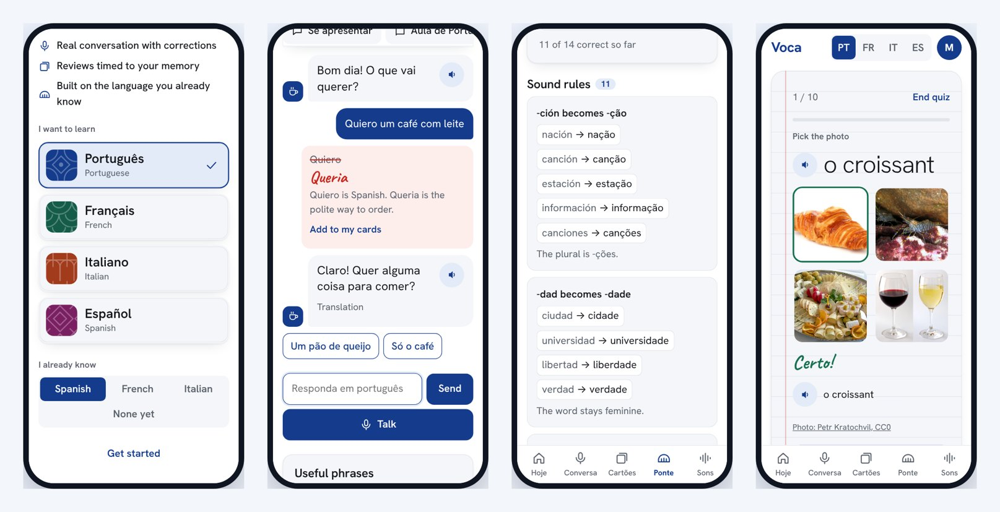
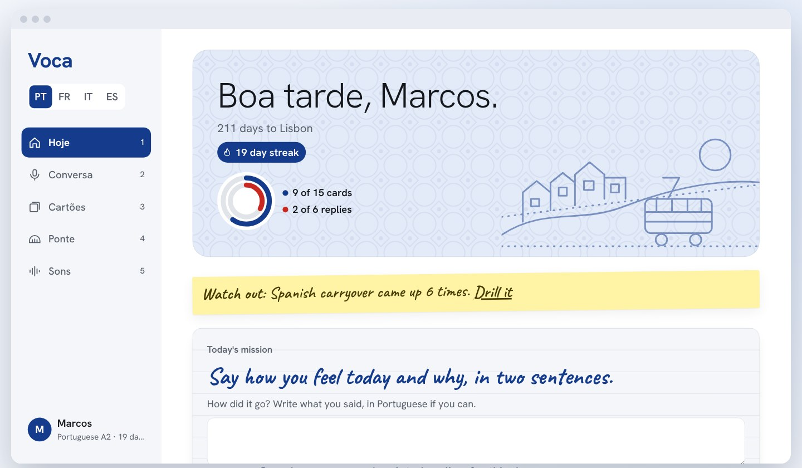

# Voca

**Learn your next language through the one you already know.**

Most language apps start every learner from zero. Voca starts from the Romance language you already speak, then uses it as a bridge. You can learn Portuguese, French, Italian or Spanish.

[Open the live app](https://voca-nine-taupe.vercel.app)





The AI features use a paid API, so they're limited to approved accounts. Cards, Bridge lessons, Sounds and Picture Words don't need the AI partner.

## What's inside

| Section | What it does |
|---|---|
| **Today** | Shows your daily goal, streak, top mistake and mission in one place. |
| **Conversation** | AI role-play in everyday situations, with corrections explained against the language you know. |
| **Recall** | Typed reviews timed to when you're likely to forget each word. |
| **Bridge** | Regular patterns, grammar changes and false friends between your languages. |
| **Sounds** | Pronunciation drills with audio. |
| **Picture Words** | 63 words taught through real photos of animals, food, nature and stores. |
| **Profile** | Levels, stamps, streaks and progress for each language. |

Each language also has a level test and photo lessons, which turn a picture of a menu or sign into cards and a practice scene.

## How it works

- **Language awareness:** your known language shapes the AI partner's corrections, the hints on Picture Words and the lessons Voca generates.
- **Bridges:** Spanish to Portuguese, French and Italian are written by hand. Other pairs are generated once and saved.
- **Memory model:** each word has its own stability score. Voca estimates recall as `0.9^(days since review / stability)`, reviews the weakest words first, and adjusts its timing from your recent results.
- **Two kinds of Portuguese:** Brazilian and Portugal forms appear side by side, and you can choose which comes first.
- **Security:** the API key stays on the server. Row-level security protects each account's data, and an allowlist controls who can use the AI features.
- **Offline use:** a service worker saves the app, so reviews and lessons keep working without a connection.

## Built with

- Vanilla JavaScript, with no framework or build step
- Vercel serverless functions and scheduled jobs
- Supabase for accounts and progress
- The Claude API for conversation, corrections and generated lessons
- Web Speech and Web Push for voices and reminders
- Node's test runner and Playwright for testing

## Photo credits

Picture Words uses photos from Wikimedia Commons. Each photo shows its author and license, and links to its source page. Photos are stored in `public/photos`. To add one, add a row to `public/lang/pictures.js` and run the **Fetch photos** GitHub workflow.

## Project layout

```text
api/        Server code that holds the API key and checks access
public/     The app, served to the phone
scripts/    Local preview server and icon generator
supabase/   Database setup
tests/      Server tests and the iPhone-size app test
vercel.json Hosting, security and timeout settings
```
